# aiops_rca

**In English:** This is a root cause analysis (RCA) for microservices. Faults are injected into the OpenTelemetry Demo plus one of our own services, each incident is recorded as a snapshot of logs, metrics and traces, and RCA methods are scored on the same incidents against rule and BARO baselines. Project 1 tests whether a small local model, helped by statistical narrowing, can find the root cause when logs may not leave the machine; Project 2 builds a tool-using agent. The documentation and the rest of this page are in Turkish.

## Amaç

Mikroservis ortamına (OpenTelemetry Demo ve kendi Python servisimiz) bilerek hata enjekte edip kök nedeni bulan yöntemleri aynı vakalar üzerinde ölçen bir altyapı. Üzerinde iki proje var: **Proje 1**, CPU'da çalışan küçük yerel model ile istatistiksel daraltmanın birlikte (hibrit) kullanımı, kanıt ve yol doğrulaması ve "emin değilim" diyebilme (kalibrasyon); **Proje 2**, sabit sorgu araçlarıyla çalışan tek bir ajan. Bütün yöntemler aynı vakalarda kural ve BARO baseline'larına karşı ölçülür. Soru: logların dışarı çıkamadığı bir ortamda küçük yerel model, doğru desteklenirse kök neden analizinde ne kadar iş görür?

## Durum

- **Proje 1 bitti:** sonuç tablosu, dev hata analizi ve sınırlamalar `results/` altında.
- **Proje 2 sürüyor:** ilk kart (P2a, ajanın sorgu araçları ve dosya ↔ canlı karşılaştırması) bitti, rapor [`results/p2a_compare.md`](results/p2a_compare.md). Ajan döngüsü ve koşuları sırada.
- **Canlı demo** (hata enjekte et → kanıtlı olay raporu) Proje 2'den sonra.
- **Snapshot seti henüz yayınlanmadı.** Vakaların ham kayıtları repo dışında; proje sonunda GitHub Releases'te sıkıştırılmış olarak yayınlanacak (tekrarlanabilirlik seviye 2). O zamana kadar deneyi baştan koşmak mümkün değil; aşağıdaki komutlar repodaki kayıtlardan sonuçları yeniden üretir.

Proje 2 bitince bu sayfa güncellenecek.

## Akış

Tam ve güncel hali [`docs/ARCHITECTURE.md`](docs/ARCHITECTURE.md)'de; buradaki kopya zamanla ondan ayrışabilir. Makineye özel yollar genel adlarla yazıldı.

```mermaid
flowchart LR
    subgraph ortam["Demo ortamı (Docker Compose)"]
        otel["OpenTelemetry Demo"]
        own["Kendi Python servisim<br/>quote-gateway (shipping → quote-gateway → quote)"]
        col["OTel collector<br/>(sızıntı süzmesi: filter/sim_world,<br/>transform/scrub)"]
    end

    inj["Hata enjeksiyonu<br/>(flagd API; altyapı: tc netem (aiops-netem),<br/>docker update --cpus, stop, pause)"]
    raw[("OTLP dosyası (süzülmüş)<br/>repo dışı telemetri klasörü")]
    rawu[("süzülmemiş kopya<br/>telemetry/raw/ (sadece --raw)")]
    mon[("Kalıcı izleme sistemi<br/>Prometheus, Jaeger, OpenSearch<br/>isimli volume, 7 gün, ≤ 40 GB")]
    cut["Snapshot kesici<br/>scenario_runner.py incidents<br/>(dosyadan, vaka penceresi;<br/>systemd birimi aiops-incidents@liste)"]
    snap[("snapshot'lar<br/>repo dışı snapshot klasörü<br/>— git dışı, ≤ 30 GB")]
    labels[("etiketler<br/>incidents/inc-….json — repoda")]
    ichk["tools/incident_checks.py<br/>(belirti, olay, taban sağlık;<br/>ölçüler src/aiops_rca/signals.py)"]
    fix[("CI alt kümesi<br/>tests/fixtures/snapshots/")]
    view["model_view<br/>(= snapshot klasörü: süzülmüş<br/>pencere + window.json; etiketler hariç)"]
    leak["Sızıntı testi<br/>src/aiops_rca/leakage.py"]
    ci["CI (GitHub Actions)<br/>.github/workflows/ci.yml"]
    img["İmajlar (GitHub Actions)<br/>.github/workflows/images.yml"]
    ghcr[("GHCR<br/>aiops-quote-gateway, aiops-netem<br/>— digest'le sabit")]

    base["baseline<br/>(kural: methods/rule.py;<br/>BARO: methods/baro.py;<br/>daraltma referansı: methods/narrowing.py)"]
    nar["candidate_narrowing<br/>(narrowing.py, ilk 5)"]
    inp["Girdi seviyeleri (inputs.py)<br/>ham / özet / daraltma, ≤ 5000 token;<br/>takma ad: alias.py"]
    llm["LLM (methods/llm.py, llm_client.py)<br/>small_local_model / large_api_model;<br/>onaylı istem, tam mesaj ≤ 6000"]
    agent["Proje 2 ajanı"]
    cache[("llm_cache/ — git dışı")]
    evr[("eval_responses/")]
    ev["Değerlendirme (evaluate score, scoring.py)<br/>top-1/3, kanıt, kalibrasyon"]
    tab["Sonuç tablosu<br/>(results.py → results/p1_table.md, .json;<br/>koşu listesi results/p1_runs.json)"]

    inj --> ortam
    otel --> col
    own --> col
    col --> raw
    col -.->|positive_control| rawu
    col --> mon
    raw --> cut --> snap
    snap --> ichk --> labels
    cut --> labels
    snap -.-> fix
    snap --> view
    view -->|"0 bulgu şartı"| leak
    ci -->|"pytest, ekstrasız kurulum"| leak
    fix -.->|baseline regresyonu| ci
    img -->|"main'de gönderim"| ghcr
    ghcr -->|docker pull, digest| ortam
    ghcr -->|netem imajı| inj
    view --> base
    view --> nar --> inp
    view -->|"WARN+ log, hata span'i, özet"| inp
    inp --> llm
    view --> fstore["FileStore (store_file.py)<br/>dosya okuyucusu"]
    fstore --> qry["Sorgu katmanı (query.py)<br/>list_services, metric_series, search_spans,<br/>get_trace, search_logs, service_dependencies;<br/>ortak hesap, METRIC_NAMES"]
    qry -->|"araçlar (P2b)"| agent
    llm -->|"evaluate run --method llm<br/>(duman, denemeler)"| cache
    llm -->|"evaluate run --method llm"| evr
    agent --> evr
    base -->|"evaluate run"| evr
    evr --> ev
    ev --> tab

    smoke["tools/api_smoke_test.py"] -.->|model seçimi| llm
    bench["tools/local_model_bench.sh<br/>+ bench_summary.py"] -.->|hız ölçümü, model boyutu| llm
    demo_sh["tools/otel_demo.sh<br/>fetch / up / down / config"] -->|"repo dışı klon 3.1.0,<br/>minimal mod"| otel
    extras["deploy/otel-demo/compose.extras.yaml<br/>(log 5 MB × 2, 3 port 127.0.0.1)"] -->|son compose katmanı| otel
    runner["tools/scenario_runner.py<br/>(10 dk normal + 10 dk flag, korumalar)"] -->|"flag aç/kapat (flagd-ui API)"| otel
    runner -->|"incidents (V1): kesim"| cut
    runner -->|"pencere kopyası (raw + filtered)"| c2runs[("repo dışı C2 koşu klasörü<br/>repo dışı, cevap içerir")]
    c2runs --> meas["tools/c2_measure.py<br/>(sızıntı, belirti, collector)"]
    meas -->|positive_control| leak
    rtest["tools/test_collector_rules.sh<br/>+ tests/fixtures/collector_rules/"] -.->|"kural testi (geçici collector, Docker)"| col
    c2runs -->|"window/filtered/<br/>(REPLAY_WINDOW)"| replay["tools/storage_check.py replay<br/>+ deploy/replay/ (otel-replay;<br/>collector: yalnız dosya alıcısı)"]
    replay -->|"orijinal zaman damgası,<br/>zaman sırasıyla"| rmon[("Yeniden oynatma hedefi<br/>Jaeger, Prometheus, OpenSearch<br/>otel-replay_* volume'leri, boş başlar")]
    snap --> rcase["tools/storage_check.py replay-case<br/>(vaka başına boş yığın, D3 şartları,<br/>örnek reddi 0, sonda down -v)"]
    rcase -->|"REPLAY_WINDOW = snapshot"| rmon
    rmon --> lstore["LiveStore (store_live.py)<br/>canlı okuyucu; Jaeger dilimleme,<br/>undo_jaeger_error_tag"]
    lstore --> qry
    qcmp["tools/query_compare.py<br/>run / report (LLM'siz)"] -->|"aynı çağrılar iki okuyucuda"| qry
    qcmp --> rcase
    qcmp -->|"fark türü kodla"| p2arep[("results/p2a_compare.md / .json")]

    classDef yok stroke-dasharray: 5 5
    class agent yok
```



## Proje 1 sonuçları (test seti)

Kaynak: [`results/p1_table.md`](results/p1_table.md) (komutla üretilir; ayrıntı bölümleri, Brier, kanıt, süre ve token oradadır). Sayılar doğru kök nedeni ilk 1'de / ilk 3'te bulan vaka sayısı. "Ham", "özet" ve "daraltma" modele verilen girdi seviyeleri; "daraltma referansı" modelsiz daraltma sırası.

| Yöntem | top-1 test | top-3 test | top-3 dev | Dev–test okuması |
|---|---|---|---|---|
| kural | 6/18 | 11/18 | 15/18 | ayırt edilemedi |
| BARO | 6/18 | 8/18 | 10/18 | ayırt edilemedi |
| daraltma referansı | 11/18 | 13/18 | 17/18 | ayırt edilemedi |
| qwen3.5-4b ham | 6/18 | 7/18 | 6/18 | ayırt edilemedi |
| qwen3.5-4b özet | 7/18 | 11/18 | 15/18 | ayırt edilemedi |
| qwen3.5-4b daraltma | 9/18 | 14/18 | 16/18 | ayırt edilemedi |
| gpt-oss-120b ham | 3/18 | 4/18 | 7/18 | ayırt edilemedi |
| gpt-oss-120b özet | 10/18 | 13/18 | 15/18 | ayırt edilemedi |
| gpt-oss-120b daraltma | 12/18 | 15/18 | 17/18 | ayırt edilemedi |
| gemini-3.5-flash-lite ham | 6/18 | 6/18 | 7/18 | ayırt edilemedi |
| gemini-3.5-flash-lite özet | 10/18 | 13/18 | 16/18 | ayırt edilemedi |
| gemini-3.5-flash-lite daraltma | 15/18 | 16/18 | 18/18 | ayırt edilemedi |

Okurken:

- "Ayırt edilemedi" "aynı" demek değil. Setler küçük olduğu için dev ile test arasında yalnız büyük farklar görülebilir (okuma kuralı tablonun altında).
- Modeller ve yöntemler arasındaki karşılaştırma betimseldir; önceden yazılmış bir karşılaştırma kuralı yok.
- Bilgi amaçlı ek model satırları ve ayrıntılar tabloda.
- Sınırlamalar: [`results/p1_limitations.md`](results/p1_limitations.md).

## Tekrar üretme

Kurulum CI'daki gibi (`pyproject.toml`'daki Python sürümü):

```
python -m venv .venv && . .venv/bin/activate
python -m pip install -e ".[dev]"
python -m aiops_rca.results --check
python -m aiops_rca.error_analysis summary --check
python -m pytest
```

İki `--check` komutu sonuç tablosunu ve hata analizi özetini repodaki kayıtlardan yeniden üretip repodakilerle karşılaştırır; CI ikisini de bayt aynı üretir. Snapshot, API anahtarı ve ağ gerekmez.

## Repo haritası

| Klasör | İçerik |
|---|---|
| `src/aiops_rca/` | Paket: vaka erişimi, sinyaller, yöntemler (kural, BARO, LLM, daraltma), puanlama, sonuç tablosu, hata analizi, sorgu katmanı |
| `tools/` | Betikler: vaka üretim hattı, ölçümler, yeniden oynatma, dosya ↔ canlı karşılaştırması |
| `tests/` | Testler ve CI'daki küçük sabit örnekler |
| `incidents/` | Vaka etiketleri (doğru cevap ve set) |
| `incident_lists/` | Gece koşularının vaka listeleri |
| `eval_responses/` | Resmî koşuların kayıtları |
| `results/` | Sonuç tabloları, hata analizi, sınırlamalar, P2a raporu |
| `deploy/` | Demo katmanları (collector süzmesi, compose), yeniden oynatma yığını, systemd birimi, yardımcı imaj |
| `services/` | Kendi servisimiz (quote-gateway) |
| `docs/` | Proje hafızası (aşağıda) |
| `.github/workflows/` | CI: testler; imajların derlenmesi ve GHCR'a gönderimi |

## Belgeler

- [`docs/PROJECT.md`](docs/PROJECT.md): ne, neden, bitti ölçütleri, şu an
- [`docs/ARCHITECTURE.md`](docs/ARCHITECTURE.md): akış şeması ve dosya tablosu
- [`docs/DECISIONS.md`](docs/DECISIONS.md): kararlar ve gerekçeleri
- [`docs/GLOSSARY.md`](docs/GLOSSARY.md): adlar
- [`docs/HANDOFF.md`](docs/HANDOFF.md): oturumlar arası kayıtlar
- [`docs/INCIDENT_CATALOG.md`](docs/INCIDENT_CATALOG.md): hata kataloğu
- [`docs/OTEL_DEMO.md`](docs/OTEL_DEMO.md): OpenTelemetry Demo kurulumu ve veri akışı
- [`docs/LOCAL_MODEL_BENCH.md`](docs/LOCAL_MODEL_BENCH.md): yerel model hız ölçümü
