# ARCHITECTURE

## Hedef yapı (taslak)

PROJECT.md'deki mimariye ve veri akışı kararına (DECISIONS 2026-10-14: dosya + kalıcı izleme sistemi) göre.
Kesik çizgili kutular henüz yok; klasör adları ihtiyaç doğduğunda onayla verilecek.

```mermaid
flowchart LR
    subgraph ortam["Demo ortamı (Docker Compose)"]
        otel["OpenTelemetry Demo"]
        own["Kendi Python servisim<br/>quote-gateway (shipping → quote-gateway → quote)"]
        col["OTel collector<br/>(sızıntı süzmesi: filter/sim_world,<br/>transform/scrub)"]
    end

    inj["Hata enjeksiyonu<br/>(flagd API; altyapı: tc netem (aiops-netem),<br/>docker update --cpus, stop, pause)"]
    raw[("OTLP dosyası (süzülmüş)<br/>~/cerebrum2/telemetry/filtered/")]
    rawu[("süzülmemiş kopya<br/>telemetry/raw/ (sadece --raw)")]
    mon[("Kalıcı izleme sistemi<br/>Prometheus, Jaeger, OpenSearch<br/>isimli volume, 7 gün, ≤ 40 GB")]
    cut["Snapshot kesici<br/>scenario_runner.py incidents<br/>(dosyadan, vaka penceresi;<br/>systemd birimi aiops-incidents@liste)"]
    snap[("snapshot'lar<br/>~/cerebrum2/snapshots/inc-…/<br/>— git dışı, ≤ 30 GB")]
    labels[("etiketler<br/>incidents/inc-….json — repoda")]
    ichk["tools/incident_checks.py<br/>(belirti, olay, taban sağlık;<br/>ölçüler src/aiops_rca/signals.py)"]
    fix[("CI alt kümesi<br/>tests/fixtures/snapshots/")]
    view["model_view<br/>(= snapshot klasörü: süzülmüş<br/>pencere + window.json; etiketler hariç)"]
    leak["Sızıntı testi<br/>src/aiops_rca/leakage.py"]
    ci["CI (GitHub Actions)<br/>.github/workflows/ci.yml"]
    img["İmajlar (GitHub Actions)<br/>.github/workflows/images.yml"]
    ghcr[("GHCR<br/>aiops-quote-gateway, aiops-netem<br/>— digest'le sabit")]

    base["baseline<br/>(kural: methods/rule.py;<br/>BARO: methods/baro.py)"]
    nar["candidate_narrowing"]
    llm["LLM<br/>small_local_model /<br/>large_api_model"]
    agent["Proje 2 ajanı"]
    cache[("llm_cache/ — git dışı")]
    evr[("eval_responses/")]
    ev["Değerlendirme (evaluate score, scoring.py)<br/>top-1/3, kanıt, kalibrasyon"]
    tab["Sonuç tablosu"]

    inj --> ortam
    otel --> col
    own --> col
    col --> raw
    col -.->|positive_control| rawu
    col --> mon
    raw --> cut --> snap
    snap --> ichk --> labels
    cut --> labels
    snap -.-> fix
    snap --> view
    view -->|"0 bulgu şartı"| leak
    ci -->|"pytest, ekstrasız kurulum"| leak
    fix -.->|baseline regresyonu| ci
    img -->|"main'de gönderim"| ghcr
    ghcr -->|docker pull, digest| ortam
    ghcr -->|netem imajı| inj
    view --> base
    view --> nar --> llm
    view -->|ham log| llm
    view -->|dosya araçları| agent
    llm --> cache
    llm --> evr
    agent --> evr
    base -->|"evaluate run"| evr
    evr --> ev
    ev --> tab

    smoke["tools/api_smoke_test.py"] -.->|model seçimi| llm
    bench["tools/local_model_bench.sh<br/>+ bench_summary.py"] -.->|hız ölçümü, model boyutu| llm
    demo_sh["tools/otel_demo.sh<br/>fetch / up / down / config"] -->|"repo dışı klon 3.1.0,<br/>minimal mod"| otel
    extras["deploy/otel-demo/compose.extras.yaml<br/>(log 5 MB × 2, 3 port 127.0.0.1)"] -->|son compose katmanı| otel
    runner["tools/scenario_runner.py<br/>(10 dk normal + 10 dk flag, korumalar)"] -->|"flag aç/kapat (flagd-ui API)"| otel
    runner -->|"incidents (V1): kesim"| cut
    runner -->|"pencere kopyası (raw + filtered)"| c2runs[("~/cerebrum2/c2_runs/<br/>repo dışı, cevap içerir")]
    c2runs --> meas["tools/c2_measure.py<br/>(sızıntı, belirti, collector)"]
    meas -->|positive_control| leak
    rtest["tools/test_collector_rules.sh<br/>+ tests/fixtures/collector_rules/"] -.->|"kural testi (geçici collector, Docker)"| col
    c2runs -->|"window/filtered/<br/>(REPLAY_WINDOW)"| replay["tools/storage_check.py replay<br/>+ deploy/replay/ (otel-replay;<br/>collector: yalnız dosya alıcısı)"]
    replay -->|"orijinal zaman damgası,<br/>zaman sırasıyla"| rmon[("Yeniden oynatma hedefi<br/>Jaeger, Prometheus, OpenSearch<br/>otel-replay_* volume'leri, boş başlar")]
    snap -.->|"Proje 2: vaka snapshot'ları"| replay
    rmon -->|canlı araçlar| agent

    classDef yok stroke-dasharray: 5 5
    class own,inj,fix,base,nar,llm,agent,cache,evr,ev,tab yok
```

- Sızıntıya karşı iki katman var: collector'daki süzme hem dosyaya hem izleme sistemine giden veriyi temizler. Sızıntı testi ise modele verilecek görünümü (`model_view`) tarar; klasör ve dosya adları da buna dahildir.
- OTel Demo çalışıyor (minimal mod, 2026-10-18). Collector süzüyor ve dosyaya yazıyor (C1, 2026-10-20); 15 gerçek senaryoyla doğrulandı (C2, 2026-10-24). İzleme sistemi kalıcı (depolama kartı, 2026-10-25): isimli volume'ler (`down` silmez), Jaeger diske (badger), saklama 7 gün (Prometheus ayrıca 2GB, OpenSearch ISM), volume toplamı ≤ 40 GB koşucu korumasında; canlı = dosya doğrulandı (D2).
- Yeniden oynatma (depolama D3, 2026-10-25) iki C2 penceresinde sınandı: izler, loglar ve metrikler canlı demodan ayrı, boş bir izleme sistemine kayıpsız gitti; Prometheus eski zamanlı örnekleri kabul ediyor ve diske yazdıktan sonra da sorgulanabiliyor. Proje 2'de `mon` vakaları tutmaz (~7 gün); ajanın canlı araçları vakaların snapshot'larından bu yolla doldurulan sisteme bakar (DECISIONS 2026-10-25).
- Vaka üretimi V1 (2026-10-25/26): `scenario_runner.py incidents` bir listedeki vakaları uçtan uca üretir (enjekte et → kaydet → temizle → snapshot + etiket → kontroller). Pilot gece 13/13 geçerli, sızıntı 0, ~27,4 dk/vaka. `inj` hâlâ kesik çizgili: flag dışı enjeksiyonlar V2'de.
- Sızıntı testi gerçek veride sınandı (C2 `positive_control`: her senaryoda raw'da bulgu, filtered temiz). Senaryo koşucusu (`scenario_runner.py`) vaka üretiminin temeli; `inj` kesik çizgili, çünkü flag dışı enjeksiyonlar (tc netem, CPU/bellek, kill) yok.

## Dosyalar

| Dosya | Görev |
|---|---|
| `README.md` | Repo tanıtımı (şimdilik sadece başlık) |
| `.gitignore` | Önbellek, gizli bilgi ve büyük veriyi git dışında tutar |
| `.gitattributes` | Satır sonlarını sabitler: metin dosyaları LF, `.bat`/`.cmd` CRLF |
| `.editorconfig` | Editörlerin yeni dosyaları LF, UTF-8 ve sonda boş satırla kaydetmesi |
| `.vscode/settings.json` | VS Code'da yeni dosyalar LF (`files.eol`) |
| `.github/workflows/ci.yml` | CI: PR'da ve main'e push'ta testler; ekstrasız kurulumun sadece `aiops_rca` eklediği ve sızıntı CLI'ının kurulu kopyadan temiz dosyada 0 döndüğü kontrolü |
| `.github/workflows/images.yml` | İmajlar: PR'da `build` (quote-gateway ve netem derlenir; `pip freeze` = `requirements.txt`, `tc -V`), main'de `publish` (aynı adımlar, GHCR'a `sha-<commit>` etiketiyle gönderir, digest'leri yazar); üçüncü taraf eylem yok |
| `pyproject.toml` | Python paket tanımı: `aiops_rca`, `src/` düzeni, Python ≥ 3.12, çalışma zamanı bağımlılığı yok, `[dev]` = `pytest==9.1.1` |
| `src/aiops_rca/__init__.py` | Paket işareti (boş) |
| `src/aiops_rca/leakage.py` | Sızıntı testi: `model_view` klasöründe cevabı ele veren izleri arar; CLI `python -m aiops_rca.leakage <klasör>`, çıkış kodu 0/1/2 |
| `src/aiops_rca/signals.py` | Vaka sinyalleri (`tools/`'tan taşındı, P1a): pencere, dosya okuma, servis satırları, sinyaller ve güç, basit kural (`rule_check`), işlem ve çağıran satırları; `trial_summary`, `c2_measure`, `incident_checks` bu adları buradan içe aktarır |
| `src/aiops_rca/cases.py` | Vaka erişimi: `load_cases()` (yönteme yalnız `incident_id`, `view`, `alarm_ns`), `load_labels()` (puanlama için); `test` yalnız `final_test`, `heldout` hiç |
| `src/aiops_rca/answer.py` | Cevap şeması ve doğrulayıcı (tam 3 aday, güven, kanıt yolu, gerekçe, `unsure`) |
| `src/aiops_rca/call_graph.py` | Snapshot izlerinden servisler arası çağrı kenarları |
| `src/aiops_rca/scoring.py` | Puanlama: ad eşleme, top-1/top-3, kanıt geçerliliği, etiket yoluyla örtüşme, Brier, seçici doğruluk, kapsama, set özeti |
| `src/aiops_rca/methods/rule.py` | Kural baseline (`rule_baseline`): `signals.rule_check` ilk 3'ü şemadaki cevaba |
| `src/aiops_rca/methods/baro.py` | BARO baseline: `baro_table` (10 sn ızgara, konteyner ve iz sütunları), `baro_rank` (RCAEval 1.9.0 `main.py` ön adımları + `baro`, saf Python), `baro_baseline` (CLI `--method baro`) |
| `src/aiops_rca/runs.py` | Koşu kaydı: `run.json`, `responses.jsonl` (koşu klasörü `<UTC>-<yöntem>/`) |
| `src/aiops_rca/evaluate.py` | CLI `python -m aiops_rca.evaluate run` / `score`: yöntemi vakalarda koşar ve kaydeder / kayıtlardan puanlar, `scores.json` ve set tablosu |
| `src/aiops_rca/llm_client.py` | LLM çağrı katmanı (P1c): beş model (`MODELS`), cevap şemasının strict biçimi, istek, taşıma hatasında tek yeniden deneme, şema kontrolü (şema dışı ve sınıra takılan yeniden sorulmaz), token ve süre; Groq aralığı (`Pacer`), yerel llama.cpp sunucusu (`LocalServer`) |
| `src/aiops_rca/inputs.py` | Girdi seviyeleri (P1c): özet (`summary_input`; `trial_summary.build`'in taşınmış hali `summary_table`) ve ham (`raw_input`: pencerenin WARN+ log ve hata span'i satırları, ≤ 5000 token, baştan kesme + işaret; boş girdi işareti). Token sayımı dışarıdan verilir |
| `eval_responses/` | Resmî koşuların kayıtları (repoda) |
| `tests/test_evaluate.py` | CLI uçtan uca (sahte snapshot): kural koşusu, şema, iki koşu aynı, puanlama, `test`/`heldout` reddi |
| `tests/test_baro.py` | BARO tablosu (ve portu) birim testleri, sentetik verilerle |
| `tests/test_llm_client.py` | LLM katmanı birim testleri, sahte sunucuyla (`127.0.0.1`, ağ ve anahtar yok): model ayarları, şema dönüşümü, şema dışı kaydı, yeniden deneme, token ve süre, Groq aralığı, anahtar okuma |
| `tests/test_inputs.py`, `tests/fixtures/summary_expected.json` | Girdi seviyeleri birim testleri (sahte tokenizer): ham satır biçimi, pencere, seçim, sıra, kesme, boş girdi / CI örneklerinde eski `trial_summary.build`'in özet metinleri (taşınan kod aynısını üretmeli) |
| `tests/fixtures/snapshots/` | CI örnekleri: 4 pilot vakanın kırpılmış görünümü (≤ 5 MB; üretici repo dışı `p1a_fixtures.py`) |
| `tests/fixtures/rule_expected.json`, `tests/test_rule_fixtures.py` | Örneklerde kural baseline'ın beklenen çıktısı ve sinyal güçleri; CI aynısını üretir |
| `tests/fixtures/baro_expected.json` | Örneklerde BARO'nun beklenen çıktısı; `tests/test_baro.py` CI'da aynısını üretir |
| `tests/test_cases.py`, `tests/test_answer.py`, `tests/test_scoring.py` | Erişim korumaları, şema ve puanlama birim testleri (sahte verilerle) |
| `tests/test_leakage.py` | Sızıntı testinin testleri (kart ölçütleri, kural biçimleri, girdi hataları) |
| `tests/fixtures/leakage/` | Sahte OTLP JSON dosyaları: `leak_*.jsonl` (OTEL_DEMO.md sızıntı tablosu), `clean_*.jsonl` (temiz, yanlış alarm adayları) |
| `docs/PROJECT.md` | Ne, neden, bitti ölçütü, kapsam dışı, şu an |
| `docs/ARCHITECTURE.md` | Bu dosya: yapı diyagramı ve dosya tablosu |
| `docs/GLOSSARY.md` | Onaylı isimler |
| `docs/DECISIONS.md` | Kararlar ve nedenleri |
| `docs/HANDOFF.md` | Oturumlar arası notlar |
| `docs/OTEL_DEMO.md` | OpenTelemetry Demo 3.1.0 keşif notları |
| `docs/INCIDENT_CATALOG.md` | Enjekte edilecek hatalar, doğru cevap kuralı, beklenen belirti ve yayılım yolları |
| `tools/api_smoke_test.py` | Aday API modellerinin teknik uygunluk testi (basit cevap, tool calling, uzun girdi) |
| `tools/otel_demo.sh` | OTel Demo 3.1.0'ı repo dışına (`~/cerebrum2/otel-demo`) klonlar ve doğrular (`fetch`); minimal modda başlatır, durdurur, birleşik compose ayarını basar (`up`, `down`, `config`); `up` sonunda OpenSearch ISM saklama kuralını yükler |
| `deploy/otel-demo/compose.extras.yaml` | Demonun boş `compose.extras.yaml`'ının yerine en son yüklenen katmanımız: log sınırı, sadece 3 host portu (`127.0.0.1`), flag dosyası ve telemetri klasörü bağlamaları, collector kullanıcısı, izleme sisteminin isimli volume'leri ve Jaeger katmanı, Prometheus boyut sınırı (2GB), Jaeger bellek sınırı (2000M) |
| `deploy/otel-demo/otelcol-config-extras.yml` | Collector katmanımız: süzme (`filter/sim_world`, `transform/scrub`), OpenSearch uyumu (`transform/backend_compat`) ve dosya çıkışı (`filtered/`), upstream pipeline listeleri korunarak |
| `deploy/otel-demo/otelcol-config-raw.yml` | Süzülmemiş paralel pipeline'lar (`raw/`), sadece `--raw` ile |
| `deploy/otel-demo/compose.raw.yaml` | Collector komutuna `otelcol-config-raw.yml`'ı ekleyen compose katmanı, sadece `--raw` ile |
| `tools/check_collector_pipelines.py` | Upstream ile bizim birleşik collector ayarını (`print-config` JSON) karşılaştırır: eksik receiver/processor/exporter ya da bozuk processor sırası → çıkış 1 |
| `tools/local_model_bench.sh` | Lokal model hız ölçümü: `matrix` (model × iş parçacığı tablosu, turlar halinde), `sustained` (30 dk bütçe döngüsü); llama.cpp sabit imajda, 10 sn izleme, priz kopmasında bekle-tekrarla, `--resume`; ham çıktılar `~/cerebrum2/bench_runs/` |
| `tools/bench_summary.py` | `local_model_bench.sh` koşularından özet: geçerli hücreleri birleştirir, soğuk/ısınmış bütçe, GEÇER/KALIR |
| `docs/LOCAL_MODEL_BENCH.md` | Lokal model hız ölçümünün kurulumu, yöntemi ve sonuç tablosu |
| `tools/scenario_runner.py` | Senaryo koşucusu: korumalar (priz, şarj 80, sıcaklık, disk, izleme volume'leri ≤ 40 GB, snapshot'lar ≤ 30 GB, güç profili, GNOME + systemd uyku engeli; liste başında boş swap ≥ 2 GB ve izleme tahmini < 40 GB); `run` (C2: `up --raw`, 10 dk normal + 10 dk flag, pencere kopyası `~/cerebrum2/c2_runs/`); `incidents` (V1 vaka üretimi: collector yeniden başlatma, ısınma, taban sağlık, enjeksiyon, anonim volume silme, snapshot kesimi `~/cerebrum2/snapshots/`, kontroller, etiket `incidents/`) |
| `tools/c2_measure.py` | C2 ölçümü: koşu klasöründen sızıntı (`positive_control`), belirti gücü (raw/filtered), yeniden yazımlar, basit kural, collector sayaçları; `measure.json`, `samples/` |
| `tools/test_collector_rules.sh` | Collector kural testi: geçici collector'a ayarımız + fixture kayıtları; kapsam, tam ayarda çıktı temiz, kural başına `delete`/`alone` (kasıtlı kırmızı). Docker ister, CI'da koşmaz |
| `tests/fixtures/collector_rules/` | Kural testi girdisi: C2 raw verisinden tek kayıtlık örnekler ve temiz kontroller (`traces/metrics/logs.jsonl`), kural listesi `rules.tsv` |
| `tools/gen_leakage_fixtures.py` | `tests/fixtures/leakage/` sahte dosyalarını üretir; dosyalar elle değil bu betikle değiştirilir |
| `tools/storage_check.py` | Depolama kartı ölçümleri: `watch` (demoyu açar, izleme sistemi ve collector'ın kaybı, büyümesi ve belleği; çıktı `~/cerebrum2/storage_runs/`), `compare` (canlı = dosya: Jaeger, OpenSearch, Prometheus ↔ `telemetry/filtered/`), `replay` (C2 pencerelerini `deploy/replay/` yığınına yeniden oynatır; gönderilen = dosya, karşılaştırma, Prometheus bloğu, ölçütler) |
| `deploy/otel-demo/jaeger-config-extras.yml` | Jaeger katmanımız: izler diske (badger, `jaeger-data` volume'ü `/tmp`'de), 7 gün saklama |
| `deploy/replay/compose.yaml` | Yeniden oynatma yığını (`otel-replay`): Jaeger, Prometheus, OpenSearch upstream tanımından `extends` ile (portlar 127.0.0.1, ayrı volume'ler), tek alıcısı dosya olan collector (`REPLAY_WINDOW`, sayaçlar 127.0.0.1:18888) |
| `deploy/replay/otelcol-replay.yml` | Yeniden oynatma collector'ı: `otlpjsonfile` alıcıları, `transform/backend_compat` ve upstream exporter kopyaları; izinli farklar `block_on_overflow` ve Jaeger paketi 2048 span |
| `tests/test_replay_config.py` | `otelcol-replay.yml`'daki kopyalar kaynaklarıyla aynı mı (`REPLAY_ONLY` dışında), alıcılar yalnız dosya mı; upstream klonu yoksa (CI) exporter testi atlanır |
| `tools/incident_checks.py` | Vaka kontrolleri (C2 ölçüsüyle aynı): işlem düzeyi belirti, olay, taban sağlık, izleme sağlığı |
| `tests/test_catalog.py` | Koşucunun doğru cevap alanları INCIDENT_CATALOG tablolarıyla aynı mı: flag senaryoları (`SCENARIOS`) ve altyapı hataları (`INFRA_ANSWERS`, `INFRA_FAULTS`, `PARAM_RE`; her satırın destek vakası geçerli ve belirtili); flag etiketlerinin kategorileri katalogla aynı (`noise_layer`'lı vakada + `noisy`); `heldout` yalnız ayrılan 6 birimde (`HELDOUT_UNITS`) |
| `tests/test_incident_checks.py` | `incident_checks.py` kurallarının sınırları (sahte OTLP girdileriyle) ve V1a eşik değerleri |
| `incident_lists/pilot.json` | Pilot gece listesi: 11 katalog senaryosu (kalibre varyant) + flood'lu 2 vaka |
| `incident_lists/v2_dry.json`, `v2b.json`, `v2c.json` | V2 listeleri: altyapı hatası kuru denemesi (6) / kalibrasyon gecesi (16) / bellek kısa koşusu (1) |
| `deploy/netem/Dockerfile` | Ağ hatası yardımcı imajı (GHCR `ghcr.io/erenbezek/aiops-netem`, digest'le sabit; sabit alpine + iproute2, giriş `tc`); hedefin ağ ad alanında yalnız NET_ADMIN ile koşar |
| `deploy/systemd/aiops-incidents@.service` | Gece koşusu birim şablonu (örnek adı = liste adı): koşucu ana süreç, `KillMode=mixed` (SIGTERM yalnız koşucuya), `TimeoutStopSec=300`, `Restart=no`; kurulum `systemctl --user link` |
| `tests/test_infra_faults.py` | Altyapı hatalarının Docker'sız testleri: dondurmanın kaydı, parametre biçimleri, zaman kalıbı, çağıran kuralı, temizlik doğrulaması, boş swap koruması, liste başı korumaları, `noise_layer`'lı vakada `noisy`, liste denetimi |
| `tests/test_v3_lists.py` | V3 gece listeleri kart tablosuyla birebir aynı mı (bileşim, gece sayıları ve sonları, ortak altyapı çiftleri ayrı gecede, ayrılan birimler yalnız testte, koşucunun liste denetimi) |
| `incident_lists/v3_night1.json`, `v3_night2.json` | V3 resmî set listeleri (20 + 20 vaka, girişte `set: dev\|test`); repo dışı üretici `~/cerebrum2/analysis/v3_lists.py`, tohum HANDOFF'ta |
| `services/quote-gateway/` | Kendi Python servisimiz `quote-gateway` (Flask + requests, OTel otomatik, OpenFeature + flagd): shipping'in fiyat isteğini quote'a iletir; `gateway.py` iş mantığı, `app.py` Flask ve flag'ler, `requirements.txt` sabit, `Dockerfile` (imaj GHCR `ghcr.io/erenbezek/aiops-quote-gateway`, digest'le sabit) |
| `deploy/otel-demo/flagd-extras.json` | quote-gateway flag'leri; `otel_demo.sh up` upstream flag dosyasıyla birleştirir |
| `tests/test_quote_gateway.py` | quote-gateway iş mantığı, flag birleştirme, koşucunun yeni flag'leri açıp kapatması |
| `incident_lists/quote_gateway.json` | quote-gateway kalibrasyon listesi (7 vaka) |
| `incident_lists/quote_gateway_leak.json` | quote-gateway kısa koşu listesi (1024 KB sızıntı, swap kapalı; 1 vaka) |
| `incidents/` | Geçerli vakaların etiketleri ve koşu kayıtları (`<incident_id>.json`) |
