# ARCHITECTURE

## Hedef yapı (taslak)

PROJECT.md'deki mimariye ve veri akışı kararına (DECISIONS 2026-10-14: dosya + kalıcı izleme sistemi) göre.
Kesik çizgili kutular henüz yok; klasör adları ihtiyaç doğduğunda onayla verilecek.

```mermaid
flowchart LR
    subgraph ortam["Demo ortamı (Docker Compose)"]
        otel["OpenTelemetry Demo"]
        own["Kendi Python servisim"]
        col["OTel collector<br/>(sızıntı süzmesi: filter/sim_world,<br/>transform/scrub)"]
    end

    inj["Hata enjeksiyonu<br/>(flagd API, tc netem, CPU/bellek, kill)"]
    raw[("OTLP dosyası (süzülmüş)<br/>~/cerebrum2/telemetry/filtered/")]
    rawu[("süzülmemiş kopya<br/>telemetry/raw/ (sadece --raw)")]
    mon[("Kalıcı izleme sistemi<br/>Prometheus, Jaeger, OpenSearch")]
    cut["Snapshot kesici<br/>(dosyadan, zaman aralığına göre)"]
    snap[("snapshot'lar<br/>snapshots/ — git dışı")]
    fix[("CI alt kümesi<br/>tests/fixtures/snapshots/")]
    view["model_view<br/>(etiketler hariç)"]
    leak["Sızıntı testi<br/>src/aiops_rca/leakage.py"]
    ci["CI (GitHub Actions)<br/>.github/workflows/ci.yml"]

    base["baseline<br/>(kural, BARO)"]
    nar["candidate_narrowing"]
    llm["LLM<br/>small_local_model /<br/>large_api_model"]
    agent["Proje 2 ajanı"]
    cache[("llm_cache/ — git dışı")]
    evr[("eval_responses/")]
    ev["Değerlendirme<br/>top-1/3, kanıt, kalibrasyon"]
    tab["Sonuç tablosu"]

    inj --> ortam
    otel --> col
    own --> col
    col --> raw
    col -.->|positive_control| rawu
    col --> mon
    raw --> cut --> snap
    snap -.-> fix
    snap --> view
    view -->|"0 bulgu şartı"| leak
    ci -->|"pytest, ekstrasız kurulum"| leak
    fix -.->|baseline regresyonu| ci
    view --> base
    view --> nar --> llm
    view -->|ham log| llm
    view -->|dosya araçları| agent
    mon -->|canlı araçlar| agent
    llm --> cache
    llm --> evr
    agent --> evr
    base --> ev
    evr --> ev
    ev --> tab

    smoke["tools/api_smoke_test.py"] -.->|model seçimi| llm
    bench["tools/local_model_bench.sh<br/>+ bench_summary.py"] -.->|hız ölçümü, model boyutu| llm
    demo_sh["tools/otel_demo.sh<br/>fetch / up / down / config"] -->|"repo dışı klon 3.1.0,<br/>minimal mod"| otel
    extras["deploy/otel-demo/compose.extras.yaml<br/>(log 5 MB × 2, 3 port 127.0.0.1)"] -->|son compose katmanı| otel

    classDef yok stroke-dasharray: 5 5
    class own,inj,mon,cut,snap,fix,view,base,nar,llm,agent,cache,evr,ev,tab yok
```

- Sızıntıya karşı iki katman var: collector'daki süzme hem dosyaya hem izleme sistemine giden veriyi temizler. Sızıntı testi ise modele verilecek görünümü (`model_view`) tarar; klasör ve dosya adları da buna dahildir.
- OTel Demo çalışıyor (minimal mod, 2026-10-18). Collector süzüyor ve dosyaya yazıyor (C1, 2026-10-20); gerçek senaryolarla doğrulama C2'de. Prometheus, Jaeger, OpenSearch açık ama kalıcı değil, bu yüzden `mon` hâlâ kesik çizgili.
- Sızıntı testi şimdilik sadece sahte dosyalarla sınandı. Gerçek veride sınanması (`positive_control`) yeni makinede yapılacak.

## Dosyalar

| Dosya | Görev |
|---|---|
| `README.md` | Repo tanıtımı (şimdilik sadece başlık) |
| `.gitignore` | Önbellek, gizli bilgi ve büyük veriyi git dışında tutar |
| `.gitattributes` | Satır sonlarını sabitler: metin dosyaları LF, `.bat`/`.cmd` CRLF |
| `.editorconfig` | Editörlerin yeni dosyaları LF, UTF-8 ve sonda boş satırla kaydetmesi |
| `.vscode/settings.json` | VS Code'da yeni dosyalar LF (`files.eol`) |
| `.github/workflows/ci.yml` | CI: PR'da ve main'e push'ta testler; ekstrasız kurulumun sadece `aiops_rca` eklediği ve sızıntı CLI'ının kurulu kopyadan temiz dosyada 0 döndüğü kontrolü |
| `pyproject.toml` | Python paket tanımı: `aiops_rca`, `src/` düzeni, Python ≥ 3.12, çalışma zamanı bağımlılığı yok, `[dev]` = `pytest==9.1.1` |
| `src/aiops_rca/__init__.py` | Paket işareti (boş) |
| `src/aiops_rca/leakage.py` | Sızıntı testi: `model_view` klasöründe cevabı ele veren izleri arar; CLI `python -m aiops_rca.leakage <klasör>`, çıkış kodu 0/1/2 |
| `tests/test_leakage.py` | Sızıntı testinin testleri (kart ölçütleri, kural biçimleri, girdi hataları) |
| `tests/fixtures/leakage/` | Sahte OTLP JSON dosyaları: `leak_*.jsonl` (OTEL_DEMO.md sızıntı tablosu), `clean_*.jsonl` (temiz, yanlış alarm adayları) |
| `docs/PROJECT.md` | Ne, neden, bitti ölçütü, kapsam dışı, şu an |
| `docs/ARCHITECTURE.md` | Bu dosya: yapı diyagramı ve dosya tablosu |
| `docs/GLOSSARY.md` | Onaylı isimler |
| `docs/DECISIONS.md` | Kararlar ve nedenleri |
| `docs/HANDOFF.md` | Oturumlar arası notlar |
| `docs/OTEL_DEMO.md` | OpenTelemetry Demo 3.1.0 keşif notları |
| `docs/INCIDENT_CATALOG.md` | Enjekte edilecek hatalar, doğru cevap kuralı, beklenen belirti ve yayılım yolları |
| `tools/api_smoke_test.py` | Aday API modellerinin teknik uygunluk testi (basit cevap, tool calling, uzun girdi) |
| `tools/otel_demo.sh` | OTel Demo 3.1.0'ı repo dışına (`~/cerebrum2/otel-demo`) klonlar ve doğrular (`fetch`); minimal modda başlatır, durdurur, birleşik compose ayarını basar (`up`, `down`, `config`) |
| `deploy/otel-demo/compose.extras.yaml` | Demonun boş `compose.extras.yaml`'ının yerine en son yüklenen katmanımız: log sınırı, sadece 3 host portu (`127.0.0.1`), flag dosyası ve telemetri klasörü bağlamaları, collector kullanıcısı |
| `deploy/otel-demo/otelcol-config-extras.yml` | Collector katmanımız: süzme (`filter/sim_world`, `transform/scrub`) ve dosya çıkışı (`filtered/`), upstream pipeline listeleri korunarak |
| `deploy/otel-demo/otelcol-config-raw.yml` | Süzülmemiş paralel pipeline'lar (`raw/`), sadece `--raw` ile |
| `deploy/otel-demo/compose.raw.yaml` | Collector komutuna `otelcol-config-raw.yml`'ı ekleyen compose katmanı, sadece `--raw` ile |
| `tools/check_collector_pipelines.py` | Upstream ile bizim birleşik collector ayarını (`print-config` JSON) karşılaştırır: eksik receiver/processor/exporter ya da bozuk processor sırası → çıkış 1 |
| `tools/local_model_bench.sh` | Lokal model hız ölçümü: `matrix` (model × iş parçacığı tablosu, turlar halinde), `sustained` (30 dk bütçe döngüsü); llama.cpp sabit imajda, 10 sn izleme, priz kopmasında bekle-tekrarla, `--resume`; ham çıktılar `~/cerebrum2/bench_runs/` |
| `tools/bench_summary.py` | `local_model_bench.sh` koşularından özet: geçerli hücreleri birleştirir, soğuk/ısınmış bütçe, GEÇER/KALIR |
| `docs/LOCAL_MODEL_BENCH.md` | Lokal model hız ölçümünün kurulumu, yöntemi ve sonuç tablosu |
| `tools/gen_leakage_fixtures.py` | `tests/fixtures/leakage/` sahte dosyalarını üretir; dosyalar elle değil bu betikle değiştirilir |
