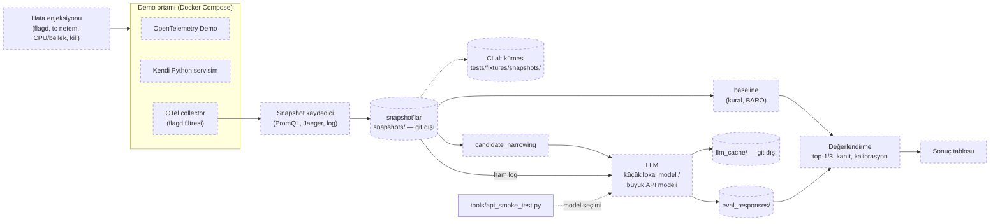

# HARİTA

## Hedef yapı (taslak)

PROJECT.md'deki mimariye göre. Kesik çizgili kutular henüz yok; klasör adları ihtiyaç doğduğunda onayla verilecek.

## Dosyalar

| Dosya | Görev |
|---|---|
| `README.md` | Repo tanıtımı (şimdilik sadece başlık) |
| `.gitignore` | Önbellek, gizli bilgi ve büyük veriyi git dışında tutar |
| `.gitattributes` | Satır sonlarını sabitler: metin dosyaları LF, `.bat`/`.cmd` CRLF |
| `.editorconfig` | Editörlerin yeni dosyaları LF, UTF-8 ve sonda boş satırla kaydetmesi |
| `.vscode/settings.json` | VS Code'da yeni dosyalar LF (`files.eol`) |
| `docs/PROJECT.md` | Ne, neden, bitti ölçütü, kapsam dışı, şu an |
| `docs/ARCHITECTURE.md` | Bu dosya: yapı diyagramı ve dosya tablosu |
| `docs/GLOSSARY.md` | Onaylı isimler |
| `docs/DECISIONS.md` | Kararlar ve nedenleri |
| `docs/HANDOFF.md` | Oturumlar arası notlar |
| `docs/OTEL_DEMO.md` | OpenTelemetry Demo 3.1.0 keşif notları |
| `docs/INCIDENT_CATALOG.md` | Enjekte edilecek hatalar, doğru cevap kuralı, beklenen belirti ve yayılım yolları |
| `tools/api_smoke_test.py` | Aday API modellerinin teknik uygunluk testi (basit cevap, tool calling, uzun girdi) |
